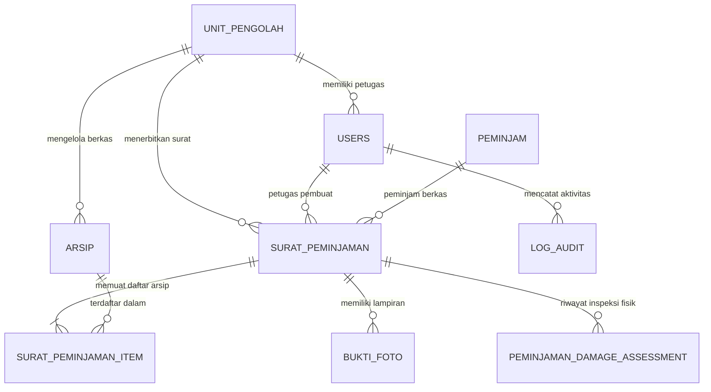

# DOKUMEN SPESIFIKASI PRODUK & KEBUTUHAN PERANGKAT LUNAK
# (PRD & SRS) SISTEM INFORMASI PEMINJAMAN ARSIP (SIPA)
**Dinas Kearsipan dan Perpustakaan Kabupaten Cirebon**  
*Versi 4.0 (Edisi Final Terintegrasi - Laporan Akhir Sistem) · November 2026*

---

> [!NOTE]  
> **Status Dokumen:** Resmi (*Baselined & Verified*).  
> Dokumen ini memuat spesifikasi produk komprehensif (PRD) dan spesifikasi kebutuhan teknis (SRS) mutakhir untuk aplikasi **SIPA (Sistem Informasi Peminjaman Arsip)** pada Dinas Kearsipan dan Perpustakaan Kabupaten Cirebon. Dokumen ini menjadi rujukan baku pengembangan, pengujian fitur (*feature testing*), perancangan sistem, serta acuan utama penyusunan **Laporan Akhir**.

---

# BAGIAN A: PRODUCT REQUIREMENTS DOCUMENT (PRD)

## 1. Latar Belakang & Identifikasi Masalah
Sebelum pengembangan sistem SIPA, sirkulasi peminjaman arsip fisik dan permohonan informasi kearsipan di lingkungan Dinas Kearsipan dan Perpustakaan Kabupaten Cirebon memiliki beberapa kendala mendasar:
1. **Peminjaman Berbasis Lisan / Tanpa Jejak Dokumen:** Sirkulasi berkas arsip sering kali hanya berdasarkan komunikasi lisan antarpegawai. Tidak adanya bukti tanda terima fisik yang sah memicu potensi hilangnya dokumen penting dinas tanpa penanggung jawab yang jelas.
2. **Ketiadaan Batas Waktu Jatuh Tempo yang Baku:** Ketiadaan pencatatan tanggal tenggat waktu peminjaman menyebabkan berkas arsip berada di luar depo penyimpanan dalam durasi yang tidak terpantau.
3. **Kesulitan Pelacakan Fisik Berkas:** Ketika suatu arsip dibutuhkan segera untuk kebutuhan administrasi kedinasan atau pemeriksaan pengawasan, petugas kesulitan mendeteksi siapa peminjam terakhir dan pada boks/rak mana berkas tersebut seharusnya berada.
4. **Rekapitulasi Laporan Tahunan yang Manual dan Tidak Akurat:** Setiap akhir tahun anggaran, pimpinan dinas memerlukan laporan kinerja pemanfaatan arsip dari masing-masing unit pengolah (bidang). Proses rekapitulasi data secara manual memakan waktu berhari-hari dan rawan kesalahan perhitungan (*human error*).
5. **Kebutuhan Layanan Informasi Multi-Format:** Peminjam tidak hanya membutuhkan peminjaman berkas fisik, tetapi juga salinan digital (PDF) atau sekadar layanan informasi di ruang baca, yang semuanya memerlukan pencatatan sirkulasi resmi.

---

## 2. Visi Produk & Gambaran Solusi (SIPA v4.0)
**SIPA (Sistem Informasi Peminjaman Arsip)** adalah platform web terpadu berbasis *multi-unit pengolah* yang dirancang untuk mengelola keseluruhan siklus hidup sirkulasi arsip secara akuntabel, tertib, dan transparan di Dinas Kearsipan dan Perpustakaan Kabupaten Cirebon.

### Pilar Solusi Utama:
* **Multi-Unit Pengolah Terintegrasi:** Mendukung 4 unit pengolah kerja:
  1. Bidang Pengelolaan Arsip (`ARS`)
  2. Sekretariat (`SEK`)
  3. Bidang Perpustakaan (`PERP`)
  4. Bidang Pelayanan dan Pengawasan Kearsipan / Bidang P2A (`P2A`)
* **Tiga Bentuk Layanan Sirkulasi Fleksibel:**
  1. **Peminjaman Fisik:** Berkas asli keluar dari depo, dilengkapi pencatatan barang jaminan (KTP/SIM/KPE/KTM), jangka waktu maksimal 7 hari kerja, dan verifikasi kondisi fisik saat kembali.
  2. **Salinan Digital (PDF):** Penerbitan dokumen salinan digital; arsip fisik asli tetap terjaga aman di rak depo kearsipan.
  3. **Layanan Informasi Langsung:** Konsultasi berkas dan telaah naskah langsung di ruang baca dinas tanpa membawa fisik berkas keluar.
* **Otomasi Dokumen Resmi & Legitimasi Tanda Tangan:** Menerbitkan Surat Peminjaman resmi berformat PDF lengkap dengan Kop Surat Dinas, nomor surat otomatis format kedinasan (`NNN/SPA/KODE-UNIT/BULAN-ROMAWI/TAHUN`), kanvas tanda tangan digital peminjam, serta identitas resmi petugas layanan (nama asli, NIP, dan bidang tugas).
* **Teknologi Cerdas (Computer Vision & Asesmen Kerusakan):** Pemindaian cerdas OpenCV di browser untuk meluruskan dokumen bukti identitas, serta fitur *Damage Assessment* untuk mendeteksi tingkat kerusakan fisik berkas (robek, noda/basah, jamur, kerapuhan).
* **Keamanan Akses Publik & Anti-Bot:** Perlindungan verifikasi human (*Math Challenge Anti-Bot*) mandiri, pembatasan frekuensi login (*Rate Limiter Throttle*), serta opsi pemulihan password via tiket administrator lokal maupun email.
* **Aksesibilitas & Pengalaman Pengguna Modern:** Tampilan responsif desktop & mobile (PWA), dukungan Mode Gelap dan Mode Terang (*Dark/Light Mode*), serta Buku Panduan Operasional 6 Langkah terintegrasi langsung di dalam sistem.

---

## 3. Tujuan Produk & Indikator Keberhasilan (KPI)

| Parameter Kinerja | Kondisi Sebelum SIPA | Target & Capaian SIPA v4.0 |
| :--- | :--- | :--- |
| **Legitimasi Peminjaman** | 0% (Hanya lisan/catatan manual lepas) | **100%** peminjaman memiliki Surat Peminjaman resmi ber-Kop Dinas & bertandatangan. |
| **Kecepatan Pelacakan Arsip** | > 15–30 menit (Cari fisik di rak manual) | **< 30 detik** melalui pencarian kode berkas, kata kunci uraian, atau filter tahun/bulan. |
| **Penyusunan Rekap Laporan Tahunan** | 3–5 hari kerja (Rekap formulir manual) | **< 5 detik** (Sekali klik ekspor PDF Landscape resmi atau Excel multi-kolom). |
| **Kepatuhan Pengembalian Tepat Waktu** | < 60% terpantau | **> 95%** dengan monitoring otomatis status Terlambat dan kontak WhatsApp peminjam. |
| **Integritas & Akuntabilitas Petugas** | Identitas pelayan tidak tercatat pasti | **100%** nama petugas, NIP, dan bidang pencatat tercetak permanen pada surat dinas. |

---

## 4. Pengguna & Matriks Hak Akses (RBAC)

Aplikasi SIPA menerapkan pembatasan hak akses berbasis peran (*Role-Based Access Control*):

| Peran Pengguna | Profil Pengguna | Cakupan & Wewenang Utama |
| :--- | :--- | :--- |
| **Super Admin** | Administrator Sistem Dinas Kearsipan & Perpustakaan | Akses penuh (*Full Control*): mengelola unit pengolah, manajemen akun seluruh bidang, melihat rekap lintas bidang, mengelola antrean tiket reset password, audit log sistem, dan konfigurasi aplikasi. |
| **Operator Unit / Bidang** | Arsiparis / Petugas Pelayanan Unit Pengolah | Mengelola master arsip unitnya, registrasi peminjam, melayani formulir peminjaman, input TTD & bukti scan OpenCV, memproses pengembalian berkas fisik, dan ekspor laporan unitnya. |
| **Kepala Bidang / Pimpinan** | Pimpinan Unit Pengolah | Memberikan persetujuan (*approval*) resmi atas permohonan peminjaman berkas yang diajukan oleh peminjam sebelum berkas diserahkan oleh petugas. |
| **Peminjam** | Pegawai Internal, Instansi SKPD, Kecamatan, atau Masyarakat/Peneliti | Tidak wajib memiliki akun sistem. Identitas, kontak WhatsApp, dan barang jaminan dicatat oleh Operator ke dalam Direktori Peminjam. |

---

## 5. Ruang Lingkup Produk

### 5.1 Fitur Termasuk (*In-Scope*):
1. **Multi-Unit Pengolah Dinamis:** Manajemen bidang kearsipan (ARS, SEK, PERP, P2A) dengan kode surat dan kuota batas pinjam masing-masing.
2. **Master Data & Impor Arsip:** CRUD data arsip, impor berkas massal dari fail Excel (`.xlsx`), filter tahun/kurun waktu, status ketersediaan (*Tersedia, Dipinjam, Hilang, Rusak*).
3. **Modal Pratinjau Detail Berkas:** Kemampuan melihat uraian informasi isi berkas, kurun waktu, jumlah lembar, dan posisi boks/rak depo sebelum memilih berkas ke keranjang peminjaman.
4. **Direktori Peminjam Terpadu:** Pengelompokan peminjam berdasarkan kategori: *Internal Disarpus, SKPD Kabupaten Cirebon, Kecamatan, dan Eksternal / Masyarakat Umum / Peneliti*, lengkap dengan pencatatan jenis jaminan fisik.
5. **Penerbitan Surat Peminjaman 3 Layanan:** Opsi layanan *Fisik, Digital (PDF), dan Layanan Informasi Langsung*.
6. **Legitimasi Petugas Layanan:** Input nama asli petugas, NIP, dan bidang tugas, dengan penolakan otomatis identitas generik "Super Admin SIPA".
7. **Tanda Tangan Peminjam:** Dukungan kanvas tanda tangan digital interaktif (HTML5 Canvas) atau tanda tangan manual di atas kertas fisik yang dipindai.
8. **Pemindai Bukti Cerdas OpenCV.js:** Modul pemindaian dokumen kartu identitas (KTP) atau surat tugas dengan koreksi perspektif (*four-point perspective transform*) otomatis di browser.
9. **Asesmen Kerusakan Berkas Fisik (*Damage Assessment*):** Formulir inspeksi kondisi lembar fisik arsip saat proses pengembalian (kategori kerusakan: robek, noda/basah, jamur, lapuk) dengan kalkulasi persentase integritas berkas.
10. **Laporan & Ekspor Ganda:** Ekspor rekapitulasi peminjaman tahunan ke format **PDF Landscape ber-Kop Dinas** dan format **Excel (.xlsx)**; ekspor direktori peminjam dan riwayat peminjam individu ke PDF.
11. **Buku Panduan & Alur Kerja Terintegrasi:** Halaman panduan 6 tahapan kerja sirkulasi, panduan peran, komparasi layanan, dan modal panduan cepat di dasbor.
12. **Mode Gelap & Mode Terang (*Dark/Light Mode*):** Pengalih tema instan dengan penyimpanan preferensi di `localStorage` dan pencegahan kedipan putih (*anti-FOUC*).
13. **Keamanan Login & Anti-Bot:** Verifikasi human hitungan mandiri (*Math Challenge*), pembatasan 5 kali salah login (*Rate Limiter Throttle*), serta penghapusan akses cepat demo untuk keamanan hosting publik.

### 5.2 Di Luar Ruang Lingkup (*Out-of-Scope*):
1. Digitalisasi massal seluruh lembar fisik gudang arsip dinas (sistem berfokus pada manajemen tata kelola sirkulasi dan distribusi salinan dokumen pemohon).
2. Tanda tangan elektronik bersertifikat (TTE) terintegrasi Badan Siber dan Sandi Negara (BSSN/BSrE) — direncanakan pada rilis fase lanjutan.
3. Pemusnahan fisik berkas arsip (tahap retensi JRA akhir dilakukan melalui berita acara manual instansi).

---

## 6. Alur Kerja Sirkulasi 6 Tahapan (End-to-End SOP)

```
[1. Pendataan Arsip] ──▶ [2. Data Peminjam] ──▶ [3. Surat Peminjaman]
(Input / Impor Excel)     (Registrasi & Jaminan) (Pilih Berkas & TTD)
                                                         │
                                                         ▼
[6. Laporan & Ekspor] ◀── [5. Pengembalian] ◀── [4. Pemindai Bukti]
(PDF & Excel Rekap)       (Cek Fisik & Selesai)   (Scan Cerdas OpenCV)
```

1. **Tahap 1 — Pendataan & Impor Berkas Arsip:** Petugas mendaftarkan arsip secara mandiri atau mengimpor file Excel master arsip ke dalam sistem. Berkas berstatus *Tersedia*.
2. **Tahap 2 — Registrasi Data Peminjam & Jaminan:** Petugas mencatat identitas pemohon, nomor WhatsApp aktif, unit instansi asal, dan menitipkan barang jaminan fisik resmi (KTP, SIM, Kartu Pegawai, atau KTM).
3. **Tahap 3 — Pembuatan Surat Peminjaman:** Petugas memilih unit pengolah, menentukan bentuk layanan (*Fisik, Digital, atau Informasi*), meninjau rincian berkas (*Lihat Detail*), memasukkan identitas asli petugas layanan, dan membubuhkan tanda tangan peminjam.
4. **Tahap 4 — Pemindaian Bukti Cerdas (OpenCV.js):** Petugas memindai kartu identitas atau surat pengantar peminjam menggunakan kamera perangkat; algoritma OpenCV meluruskan citra dokumen secara simetris dan mengompresi ukuran berkas.
5. **Tahap 5 — Pengembalian Berkas & Asesmen Kerusakan Fisik:** Saat berkas fisik dikembalikan, petugas melakukan cek fisik lembar arsip menggunakan form asesmen kerusakan. Berkas kembali menjadi *Tersedia*, status surat menjadi *Selesai*, dan kartu jaminan diserahkan kembali.
6. **Tahap 6 — Laporan Tahunan & Rekapitulasi Ekspor:** Evaluasi tren peminjaman bulanan dan ekspor berkas rekapitulasi resmi ber-Kop Dinas ke format PDF Lanskap maupun Excel.

---

# BAGIAN B: SOFTWARE REQUIREMENTS SPECIFICATION (SRS)

## 1. Pendahuluan & Lingkungan Teknis

### 1.1 Tujuan Dokumen
Dokumen SRS ini mendefinisikan kebutuhan fungsional (*functional requirements*), kebutuhan non-fungsional (*non-functional requirements*), struktur basis data, arsitektur teknis, dan rancangan antarmuka perangkat lunak SIPA versi 4.0.

### 1.2 Lingkungan Teknologi & Dependensi
* **Bahasa Pemrograman:** PHP 8.2 / 8.3
* **Framework Backend:** Laravel 10.x / 11.x
* **Basis Data Utama:** MySQL 8.0+ / MariaDB 10.4+ (Engine InnoDB, Charset `utf8mb4_unicode_ci`)
* **Framework Antarmuka (Frontend):** Blade Templating Engine, Bootstrap 5.3.3, Bootstrap Icons 1.11.3
* **Pustaka Pemrosesan Citra di Browser:** OpenCV.js (WebAssembly)
* **Pustaka Tanda Tangan Digital:** Signature Pad (HTML5 Canvas API)
* **Pustaka Dokumen PDF:** `barryvdh/laravel-dompdf` (v3.1)
* **Pustaka Spreadsheet Excel:** `phpoffice/phpspreadsheet` (v1.29)
* **Dukungan Mobile & PWA:** Web App Manifest (`manifest.webmanifest`), Service Worker (`sw.js`)

---

## 2. Arsitektur Perangkat Lunak

```
+-------------------------------------------------------------------------------+
|                                CLIENT BROWSER                                 |
|  - UI: Bootstrap 5.3 + Dark/Light Theme Switcher (localStorage + Anti-FOUC)   |
|  - TTD: SignaturePad HTML5 Canvas                                             |
|  - Scanner: OpenCV.js (Canny Edge Detection + Perspective Transform)          |
|  - PWA: Service Worker Caching & Offline Fallback                             |
+---------------------------------------+---------------------------------------+
                                        | HTTPS / REST Request
                                        v
+-------------------------------------------------------------------------------+
|                           WEB SERVER & LARAVEL CORE                           |
|  - Routing: Web Routes with Fallback Storage Delivery Controller              |
|  - Middleware: Authenticated, Role-Based Access Control, Session Handling     |
|  - Rate Limiter: Login Throttle (Max 5 attempts / 60 seconds)                 |
|  - Controllers: Auth, Dasbor, Arsip, Peminjam, Surat, Laporan, OpenCV         |
|  - Services: Number Generator, Excel Importer/Exporter, DomPDF Streamer       |
+-------------------+-----------------------------------+-----------------------+
                    | SQL (PDO Connection)              | Filesystem
                    v                                   v
+---------------------------------------+   +-----------------------------------+
|               MYSQL 8.0               |   |          LOCAL STORAGE            |
|  (Tables: arsip, surat, peminjam,     |   |  (public disk: storage/app/public |
|   users, damage_assessments, log)     |   |   delivery via Laravel route)     |
+---------------------------------------+   +-----------------------------------+
```

---

## 3. Kamus Data & Desain Skema Basis Data Relasional (MySQL)

Sistem menggunakan 13 tabel utama yang saling berelasi dengan integritas referensial *Foreign Key*:



### 3.1 Tabel `unit_pengolah`
Menyimpan data unit pengolah / bidang kearsipan.
* `id` (BIGINT UNSIGNED, Primary Key, Auto Increment)
* `kode` (VARCHAR(10), Unique) — Contoh: `'ARS'`, `'SEK'`, `'PERP'`, `'P2A'`
* `nama` (VARCHAR(150)) — Contoh: `'Bidang Pengelolaan Arsip'`, `'Bidang P2A'`
* `kepala_nama` (VARCHAR(150), Nullable) — Nama Kepala Bidang untuk kolom tanda tangan mengetahui
* `kepala_nip` (VARCHAR(30), Nullable) — NIP Kepala Bidang
* `lama_pinjam_standar` (SMALLINT, Default: 7) — Durasi pinjam standar dalam hari
* `lama_pinjam_maks` (SMALLINT, Default: 7) — Durasi batas pinjam maksimal
* `aktif` (TINYINT(1), Default: 1)

### 3.2 Tabel `users`
Menyimpan akun pengguna sistem.
* `id` (BIGINT UNSIGNED, Primary Key, Auto Increment)
* `unit_pengolah_id` (BIGINT UNSIGNED, Nullable, Foreign Key ke `unit_pengolah.id`)
* `name` (VARCHAR(150)) — Nama lengkap pengguna
* `username` (VARCHAR(60), Unique) — Username login
* `nip` (VARCHAR(30), Nullable) — NIP pegawai
* `password` (VARCHAR(255)) — Password terenkripsi Bcrypt
* `role` (ENUM('superadmin', 'operator', 'pimpinan', 'auditor'), Default: 'operator')
* `aktif` (TINYINT(1), Default: 1)

### 3.3 Tabel `peminjam`
Menyimpan profil peminjam berkas.
* `id` (BIGINT UNSIGNED, Primary Key, Auto Increment)
* `nama` (VARCHAR(150)) — Nama peminjam
* `jenis` (ENUM('Internal', 'SKPD', 'Kecamatan', 'Eksternal'), Default: 'Internal')
* `nip_nik` (VARCHAR(40), Nullable) — NIP (pegawai internal) atau NIK (eksternal/umum)
* `jabatan` (VARCHAR(100), Nullable)
* `instansi_unit` (VARCHAR(150), Nullable) — Asal dinas / fakultas / perusahaan
* `alamat` (TEXT, Nullable)
* `no_hp` (VARCHAR(30), Nullable) — Nomor WhatsApp aktif
* `jaminan` (VARCHAR(100), Nullable) — Jenis barang jaminan identitas fisik

### 3.4 Tabel `arsip`
Menyimpan katalog master data arsip.
* `id` (BIGINT UNSIGNED, Primary Key, Auto Increment)
* `unit_pengolah_id` (BIGINT UNSIGNED, Foreign Key ke `unit_pengolah.id`)
* `unit_pengolah_asal` (VARCHAR(150), Nullable) — Unit pencipta asal berkas
* `kode_internal` (VARCHAR(60), Unique) — Nomor berkas internal
* `kode_klasifikasi` (VARCHAR(100), Nullable) — Kode klasifikasi arsip
* `uraian_berkas` (TEXT) — Ringkasan judul berkas
* `uraian_informasi` (LONGTEXT, Nullable) — Rincian lengkap isi berkas arsip
* `tanggal_surat` (DATE, Nullable)
* `tahun` (INT, Nullable) — Tahun pembuatan berkas
* `kurun_waktu` (VARCHAR(100), Nullable) — Rentang tahun berkas
* `jumlah_lembar` (INT, Default: 1)
* `lokasi_simpan` (VARCHAR(200), Nullable) — Nama depo, nomor rak, dan nomor boks
* `status_ketersediaan` (ENUM('Tersedia', 'Dipinjam', 'Hilang', 'Rusak'), Default: 'Tersedia')
* `aktif` (TINYINT(1), Default: 1)

### 3.5 Tabel `surat_peminjaman`
Menyimpan lembar transaksi sirkulasi peminjaman.
* `id` (BIGINT UNSIGNED, Primary Key, Auto Increment)
* `nomor_surat` (VARCHAR(60), Unique) — Format: `001/SPA/ARS/XI/2026`
* `tanggal_surat` (DATE) — Tanggal terbit surat
* `unit_pengolah_id` (BIGINT UNSIGNED, Foreign Key ke `unit_pengolah.id`)
* `peminjam_id` (BIGINT UNSIGNED, Foreign Key ke `peminjam.id`)
* `bentuk_layanan` (ENUM('Fisik', 'Digital', 'Informasi'), Default: 'Fisik')
* `maksud_keperluan` (TEXT) — Tujuan peminjaman
* `jaminan` (VARCHAR(100), Nullable) — Barang jaminan peminjaman fisik
* `tanggal_mulai` (DATE) — Tanggal awal peminjaman
* `tanggal_kembali` (DATE) — Tanggal tenggat pengembalian berkas
* `lama_pinjam_hari` (SMALLINT) — Durasi pinjam (maksimal 7 hari)
* `diperpanjang_kali` (SMALLINT, Default: 0) — Riwayat perpanjangan (maksimal 2 kali)
* `butuh_persetujuan` (TINYINT(1), Default: 1)
* `status_persetujuan` (ENUM('Menunggu', 'Disetujui', 'Ditolak'), Default: 'Menunggu')
* `metode_ttd` (ENUM('Digital', 'Manual'), Default: 'Digital')
* `ttd_peminjam_path` (VARCHAR(255), Nullable) — Path file gambar TTD peminjam
* `surat_ttd_path` (VARCHAR(255), Nullable) — Path scan surat fisik bertanda tangan
* `petugas_id` (BIGINT UNSIGNED, Foreign Key ke `users.id`) — Akun petugas login
* `petugas_layanan_nama` (VARCHAR(150), Nullable) — Nama asli petugas yang melayani
* `petugas_layanan_nip` (VARCHAR(30), Nullable) — NIP asli petugas pelayanan
* `petugas_layanan_bidang` (VARCHAR(150), Nullable) — Bidang tugas petugas pelayanan
* `status` (ENUM('Draf', 'Menunggu Persetujuan', 'Aktif', 'Selesai', 'Terlambat', 'Ditolak'), Default: 'Aktif')
* `tanggal_selesai` (TIMESTAMP, Nullable)

### 3.6 Tabel `surat_peminjaman_item`
Menghubungkan satu surat peminjaman dengan satu atau banyak berkas arsip (*multi-item*).
* `id` (BIGINT UNSIGNED, Primary Key, Auto Increment)
* `surat_id` (BIGINT UNSIGNED, Foreign Key ke `surat_peminjaman.id` ON DELETE CASCADE)
* `arsip_id` (BIGINT UNSIGNED, Foreign Key ke `arsip.id`)
* `kondisi_keluar` (VARCHAR(100), Default: 'Baik')
* `kondisi_kembali` (VARCHAR(100), Nullable)
* `tanggal_kembali_riil` (DATE, Nullable)
* `catatan` (TEXT, Nullable)

### 3.7 Tabel `peminjaman_damage_assessments`
Menyimpan riwayat inspeksi fisik berkas saat pengembalian arsip.
* `id` (BIGINT UNSIGNED, Primary Key, Auto Increment)
* `surat_peminjaman_id` (BIGINT UNSIGNED, Foreign Key ke `surat_peminjaman.id`)
* `arsip_id` (BIGINT UNSIGNED, Foreign Key ke `arsip.id`)
* `is_robek` (TINYINT(1), Default: 0)
* `is_noda_cairan` (TINYINT(1), Default: 0)
* `is_jamur` (TINYINT(1), Default: 0)
* `is_kerapuhan` (TINYINT(1), Default: 0)
* `tingkat_kerusakan` (ENUM('Ringan', 'Sedang', 'Berat'), Default: 'Ringan')
* `persentase_kerusakan` (DECIMAL(5,2), Default: 0.00)
* `foto_kerusakan_path` (VARCHAR(255), Nullable)
* `catatan_petugas` (TEXT, Nullable)

---

## 4. Kebutuhan Fungsional (*Functional Requirements*)

### 4.1 Modul Autentikasi & Keamanan (FR-01 s/d FR-06)
* **FR-01:** Sistem menyediakan antarmuka login yang memvalidasi username, password, dan verifikasi human (*Math Challenge*).
* **FR-02:** Sistem menghasilkan soal penjumlahan matematika acak (contoh: `A + B = ?`) yang tersimpan di sesi server dan menyediakan tombol *Ganti Soal* via AJAX (`/captcha/refresh`).
* **FR-03:** Sistem membatasi percobaan login maksimal 5 kali berturut-turut (*Rate Limiter Throttle*). Jika gagal, login dikunci selama 60 detik.
* **FR-04:** Halaman login tidak menampilkan tombol pengisian instan (*Akun Cepat Pengujian*) demi menjaga kerahasiaan kredensial saat online.
* **FR-05:** Sistem menyediakan pemulihan password melalui 2 jalur: kirim tautan reset via email atau tiket permohonan ke Super Admin.
* **FR-06:** Sistem mencatat setiap sesi login dan logout ke dalam tabel `log_audit`.

### 4.2 Modul Master Data Arsip (FR-07 s/d FR-13)
* **FR-07:** Petugas dapat menambah, melihat, menyunting, dan menghapus (*soft/hard delete*) data arsip unitnya.
* **FR-08:** Sistem mendukung impor massal berkas dari Excel (`.xlsx`) dengan validasi kode internal berkas yang unik.
* **FR-09:** Sistem menyediakan fitur pencarian cepat (*live search*), filter tahun, filter status ketersediaan, dan filter kurun waktu.
* **FR-10:** Sistem menampilkan modal pratinjau (*Lihat Detail*) yang memuat uraian berkas, naskah informasi, kurun waktu, dan lokasi rak/boks depo.
* **FR-11:** Sistem secara otomatis mengubah status arsip menjadi *Dipinjam* saat surat peminjaman berstatus *Aktif*, dan kembali menjadi *Tersedia* saat proses pengembalian selesai.

### 4.3 Modul Data Peminjam (FR-14 s/d FR-17)
* **FR-12:** Sistem mencatat profil peminjam dengan kategori: *Internal, SKPD, Kecamatan, dan Eksternal*.
* **FR-13:** Sistem mewajibkan pencatatan barang jaminan identitas fisik (KTP, SIM, Kartu Pegawai, KTM) untuk peminjaman berkas fisik.
* **FR-14:** Sistem menyediakan tombol pintas kontak WhatsApp langsung ke nomor peminjam untuk pemberitahuan keterlambatan.
* **FR-15:** Sistem menyediakan ekspor direktori peminjam ke format PDF dan ekspor riwayat peminjaman perorangan ke format PDF.

### 4.4 Modul Transaksi Sirkulasi & Surat Peminjaman (FR-18 s/d FR-27)
* **FR-16:** Petugas dapat membuat surat peminjaman dengan memilih unit pengolah (termasuk Bidang P2A).
* **FR-17:** Petugas dapat memilih 3 bentuk layanan: *Fisik, Digital (PDF), atau Layanan Informasi Langsung*.
* **FR-18:** Sistem menghasilkan nomor surat dinas otomatis berurut per unit dan per tahun.
* **FR-19:** Sistem membatasi lama pinjam maksimal 7 hari kerja dengan opsi perpanjangan maksimal 2 kali.
* **FR-20:** Sistem mewajibkan pengisian nama asli, NIP, dan bidang petugas pelayanan, serta menolak tegas nama default "Super Admin SIPA".
* **FR-21:** Sistem menyediakan kanvas tanda tangan digital peminjam berbasis HTML5 Canvas yang dikonversi ke gambar PNG transparan.
* **FR-22:** Sistem mengizinkan opsi tanda tangan manual dengan mengunggah foto surat fisik yang sudah dibubuhi tanda tangan basah.
* **FR-23:** Sistem menyediakan tombol cetak / unduh Surat Peminjaman PDF berformat Kop Dinas Kabupaten Cirebon.

### 4.5 Modul Pemindaian Cerdas OpenCV & Asesmen Kerusakan (FR-28 s/d FR-32)
* **FR-24:** Sistem menyediakan modul kamera di browser yang memanfaatkan OpenCV.js untuk mendeteksi kontur kartu identitas / dokumen.
* **FR-25:** Sistem menerapkan transformasi perspektif (*four-point perspective transform*) untuk meluruskan citra dokumen miring secara otomatis.
* **FR-26:** Sistem menyediakan formulir inspeksi kondisi fisik saat proses pengembalian berkas fisik (kategori robek, noda, jamur, kerapuhan).
* **FR-27:** Sistem menghitung persentase tingkat kerusakan berkas dan menyimpannya ke dalam histori surat peminjaman.

### 4.6 Modul Pelaporan & Antarmuka (FR-33 s/d FR-38)
* **FR-28:** Sistem menyajikan statistik dasbor: total arsip tersedia, arsip dipinjam, surat aktif, dan peringatan surat terlambat.
* **FR-29:** Sistem menyediakan ekspor laporan tahunan ke format **PDF Landscape resmi** dan **Excel (.xlsx)** multi-kolom.
* **FR-30:** Sistem menyediakan halaman Buku Panduan Operasional 6 Langkah dengan rincian SOP dan FAQ terintegrasi di `/panduan`.
* **FR-31:** Sistem menyediakan Modal Panduan Cepat di dasbor.
* **FR-32:** Sistem menyediakan tombol alih Mode Gelap dan Terang (*Dark/Light Mode*) di topbar dan halaman login dengan persistensi `localStorage`.

---

## 5. Kebutuhan Non-Fungsional (*Non-Functional Requirements*)

### 5.1 Keamanan (*Security*)
1. **Enkripsi Password:** Seluruh password pengguna disimpan menggunakan algoritma *Bcrypt* dengan cost factor 12.
2. **Proteksi Serangan Web:**
   * Proteksi *Cross-Site Request Forgery* (CSRF) aktif pada seluruh formulir transaksi (`@csrf`).
   * Proteksi *SQL Injection* terjamin melalui penggunaan *Prepared Statements* via Eloquent ORM / PDO.
   * Proteksi *Cross-Site Scripting* (XSS) melalui *Blade automatic HTML escaping* (`{{ }}`).
3. **Anti Brute-Force & Bot:** Pembatasan *Rate Limiter* maksimal 5 kali kegagalan login per menit, dan verifikasi hitungan matematika dinamis di sisi server.
4. **Isolasi File Sensitif:** File konfigurasi `.env` dan direktori inti dilarang diakses langsung melalui browser publik web root.
5. **Aman Tanpa Symlink:** File delivery controller khusus di [routes/web.php](file:///d:/CODING/SIPA/routes/web.php#L34-L40) menyajikan dokumen publik secara aman meskipun server hosting tidak mendukung perintah *symlink*.

### 5.2 Performa (*Performance*)
1. Waktu respon pembuatan halaman web rata-rata di bawah **1.5 detik** pada koneksi standar.
2. Waktu pembuatan fail PDF Surat Peminjaman dan Laporan Tahunan di bawah **3 detik**.
3. Kompresi gambar tanda tangan dan foto bukti OpenCV dijaga maksimal **500 KB** per fail untuk menghemat ruang simpan hosting.

### 5.3 Keandalan & Ketersediaan (*Reliability & Availability*)
1. Sistem dirancang mampu beroperasi pada lingkungan shared hosting bersumber daya terbatas (RAM 128 MB, PHP Timeout 30 detik).
2. Sistem dilengkapi *Database Transactions* (`DB::beginTransaction()`, `commit()`, `rollBack()`) pada pembuatan surat untuk mencegah inkonsistensi data ketika terjadi kegagalan jaringan.

---

## 6. Panduan Penerapan Hosting Produksi (Deployment Blueprint)

### 6.1 Struktur Penataan Folder Aman di Shared Hosting / InfinityFree
Untuk mencegah kebocoran file kredensial `.env`, struktur penataan folder di server harus dipisahkan:

```
/home/volXX_X/epiz_XXXXXXXX/
├── htdocs/                          <-- HANYA BERISI ISI DARI FOLDER public/
│   ├── index.php                   <-- Membaca ke ../sipa_core/
│   ├── .htaccess
│   ├── manifest.webmanifest
│   └── images/
└── sipa_core/                       <-- SELURUH FOLDER LARAVEL (DI LUAR WEB ROOT)
    ├── app/
    ├── bootstrap/
    ├── config/
    ├── database/
    ├── resources/
    ├── routes/
    ├── storage/
    ├── vendor/
    └── .env                         <-- AMAN, TIDAK BISA DIUNDUH PUBLIK
```

### 6.2 Prosedur Ekspor-Impor Basis Data
* File basis data siap pakai telah diekspor di [database_sipa_production.sql](file:///d:/CODING/SIPA/database_sipa_production.sql).
* Pada dashboard hosting (cPanel / VistaPanel), buat database MySQL baru, buka phpMyAdmin, lalu lakukan **Import** langsung pada file tersebut.

---

## 7. Riwayat Versi Dokumen (Revision History)

| Versi | Tanggal | Deskripsi Pembaruan |
| :--- | :--- | :--- |
| **v1.0** | 10 Okt 2026 | Inisiasi awal arsitektur SIPA (peminjaman fisik dasar). |
| **v2.0** | 25 Okt 2026 | Integrasi OCR Tesseract.js dan modul foto webcam. |
| **v3.0** | 5 Nov 2026 | Multi-unit pengolah, integrasi PostgreSQL, dan ekspor dasar. |
| **v4.0** | 16 Nov 2026 | **Edisi Final Laporan Akhir:** Transisi ke MySQL 8.0, 3 bentuk layanan (Fisik, Digital, Informasi), unit Bidang P2A, identitas asli petugas pelayanan, pemindai cerdas OpenCV.js, formulir *Damage Assessment* berkas fisik, ekspor PDF Landscape ber-Kop Dinas, buku panduan 6 langkah interaktif, Mode Gelap/Terang, verifikasi human *Math Challenge*, rate limiter anti-bot, dan deployment blueprint hosting. |
